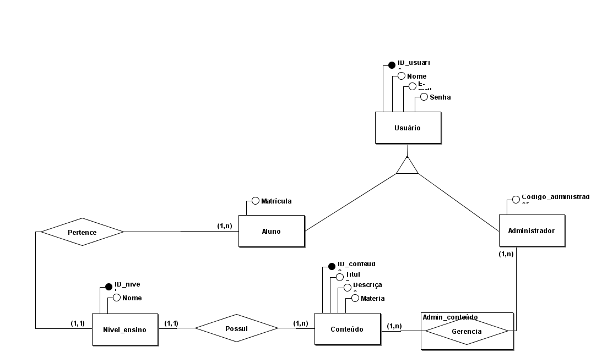
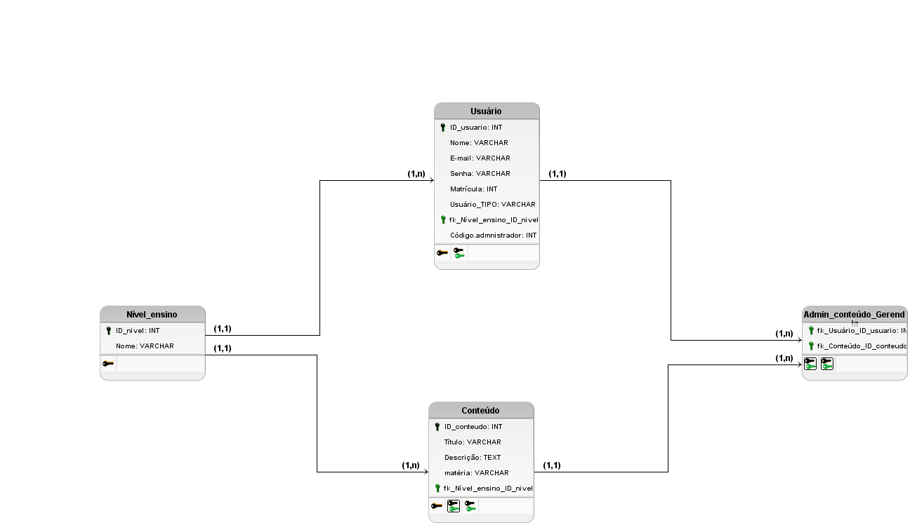

# Site-educacional
Plataforma web educacional gratuita para consulta de conteúdos do Ensino Fundamental e do Ensino Médio.  

# Plataforma Educacional

## 1. Sobre o projeto

A Plataforma Educacional é um sistema web que tem como objetivo disponibilizar conteúdos escolares gratuitos do Ensino Fundamental e do Ensino Médio.

O sistema permitirá que os usuários acessem os níveis de ensino e consultem conteúdos educacionais organizados por matéria, facilitando a busca por informações e materiais de estudo.

A plataforma também contará com administradores responsáveis pelo gerenciamento dos conteúdos disponibilizados.

## 2. Objetivo

Desenvolver um sistema web educacional que facilite o acesso a conteúdos escolares gratuitos, organizados de acordo com o nível de ensino e a matéria correspondente.

## 3. Funcionalidades principais

- Cadastro e identificação de usuários.
- Acesso dos alunos aos níveis de ensino.
- Consulta de conteúdos educacionais.
- Organização dos conteúdos por nível de ensino e matéria.
- Gerenciamento dos conteúdos pelos administradores.

## 4. Requisitos 

- **R01:** O sistema deve armazenar os dados dos usuários.
- **R02:** O sistema deve distinguir alunos e administradores.
- **R03:** O sistema deve permitir que os alunos acessem os níveis de ensino.
- **R04:** O sistema deve disponibilizar conteúdos educacionais associados aos níveis de ensino.
- **R05:** O sistema deve permitir a consulta dos conteúdos por matéria.
- **R06:** O sistema deve permitir que os administradores gerenciem os conteúdos.

## 5. Regras

- **R01:** A plataforma será destinada à disponibilização de conteúdos do Ensino Fundamental e do Ensino Médio.
- **R02:** Os usuários serão classificados como alunos ou administradores.
- **R03:** Os alunos estarão relacionados aos níveis de ensino por meio do relacionamento Pertence.
- **R04:** Os níveis de ensino estarão relacionados aos conteúdos por meio do relacionamento Possui.
- **R05:** Cada conteúdo estará associado a um nível de ensino.
- **R06:** Os administradores serão responsáveis pelo gerenciamento dos conteúdos.
- **R07:** Os conteúdos terão título, descrição e matéria.

## 6. Modelo Entidade-Relacionamento (MER)

O modelo conceitual do banco de dados é composto pelas seguintes entidades:

### Usuário
Armazena as informações gerais dos usuários, incluindo identificador, nome, e-mail e senha.

### Aluno
Representa o usuário que acessa os níveis de ensino e consulta os conteúdos educacionais. Possui o atributo matrícula.

### Administrador
Representa o usuário responsável pelo gerenciamento dos conteúdos da plataforma. Possui o atributo código_administrador

### Nível de Ensino
Representa os níveis escolares disponibilizados pelo sistema, como Ensino Fundamental e Ensino Médio.

### Conteúdo
Armazena os materiais educacionais disponibilizados na plataforma, incluindo identificador, título, descrição e matéria.

### Relacionamentos

- **Pertence:** relaciona os alunos aos níveis de ensino.
- **Possui:** relaciona os níveis de ensino aos conteúdos.
- **Admin_conteúdo (Gerencia):** representa o gerenciamento dos conteúdos pelos administradores.

A entidade Usuário é especializada em Aluno e Administrador, permitindo que os dois tipos compartilhem os atributos gerais de usuário.

### Imagem do modelo conceitual

## 7. Modelo Lógico/Relacional

O modelo lógico foi derivado do MER e apresenta as tabelas, os atributos, os tipos de dados, as chaves primárias (PK), as chaves estrangeiras (FK) e as restrições de integridade do banco de dados.

### Diagrama do modelo lógico

### 1. Tabela USUARIO

Armazena os dados dos usuários cadastrados na plataforma, permitindo identificar alunos e administradores.

| Atributo | Tipo de dado | Restrições |
|---|---|---|
| `id_usuario` | INT | PK |
| `nome` | VARCHAR(100) | NOT NULL |
| `email` | VARCHAR(150) | NOT NULL, UNIQUE |
| `senha` | VARCHAR(255) | NOT NULL |
| `usuario_TIPO` | VARCHAR(20) | NOT NULL |
| `codigo_administrador` | VARCHAR(50) | Opcional |
| `Nivel_ensino_ID_nivel` | INT | FK |

### 2. Tabela NIVEL_ENSINO

Armazena os níveis de ensino disponibilizados pela plataforma.

| Atributo | Tipo de dado | Restrições |
|---|---|---|
| `ID_nivel` | INT | PK |
| `Nome` | VARCHAR(50) | NOT NULL |

### 3. Tabela CONTEUDO

Armazena os conteúdos educacionais disponibilizados aos usuários, incluindo título, descrição, matéria e o nível de ensino ao qual pertencem.

| Atributo | Tipo de dado | Restrições |
|---|---|---|
| `ID_conteúdo` | INT | PK |
| `Título` | VARCHAR(150) | NOT NULL |
| `Descrição` | TEXT | NOT NULL |
| `matéria` | VARCHAR(100) | NOT NULL |
| `fk_Nivel_ensino_ID_nivel` | INT | FK |

### 4. Tabela ADMIN_CONTEUDO_GERENCIA

Registra o relacionamento entre os usuários administradores e os conteúdos que eles gerenciam.

| Atributo | Tipo de dado | Restrições |
|---|---|---|
| `fk_Usuário_ID_usuário` | INT | PK, FK |
| `fk_Conteúdo_ID_Conteúdo` | INT | PK, FK |

A tabela `ADMIN_CONTEUDO_GERENCIA` utiliza uma chave primária composta pelas duas chaves estrangeiras, identificando cada associação entre um administrador e um conteúdo.

## Chaves e relacionamentos

- **USUARIO:** a chave primária `id_usuario` identifica cada usuário.
- **NIVEL_ENSINO:** a chave primária `ID_nivel` identifica cada nível de ensino.
- **CONTEUDO:** a chave primária `ID_conteúdo` identifica cada conteúdo. A chave estrangeira `fk_Nivel_ensino_ID_nivel` referencia `NIVEL_ENSINO.ID_nivel`.
- **ADMIN_CONTEUDO_GERENCIA:** relaciona `USUARIO` e `CONTEUDO` por meio de suas chaves estrangeiras, permitindo registrar quais administradores gerenciam quais conteúdos.

## Normalização

### Primeira Forma Normal (1FN)

Uma tabela está na 1FN quando cada atributo contém um único valor, sem listas ou grupos repetidos.

No projeto, os atributos são separados em campos individuais, como o título, a descrição e a matéria de cada conteúdo.

### Segunda Forma Normal (2FN)

Uma tabela está na 2FN quando atende à 1FN e todos os atributos que não fazem parte de uma chave dependem da chave primária completa.

Na tabela `ADMIN_CONTEUDO_GERENCIA`, a chave primária é composta por duas chaves estrangeiras. Como não existem outros atributos nessa tabela, não há atributos não-chave com dependências parciais a verificar.

### Terceira Forma Normal (3FN)

Uma tabela está na 3FN quando atende à 2FN e não possui dependências transitivas indevidas entre atributos que não são chaves.

A separação entre `NIVEL_ENSINO` e `CONTEUDO` permite armazenar os nomes dos níveis de ensino em uma tabela própria e relacioná-los aos conteúdos por meio de uma chave estrangeira.

## Integridade dos dados

As chaves primárias identificam os registros de forma única, enquanto as chaves estrangeiras estabelecem os relacionamentos entre as tabelas.

As restrições `NOT NULL` indicam atributos obrigatórios, e `UNIQUE` impede a repetição de valores no e-mail dos usuários.

## 8. Tecnologias

- Modelagem conceitual do banco de dados: brModelo 3.2.
- Sistema web e banco de dados: a definir.

## 9. Status do projeto

Projeto acadêmico em desenvolvimento, com o modelo conceitual e modelo lógico do banco de dados elaborado.

## 10. Autores

- João Gabriel
- Caio
